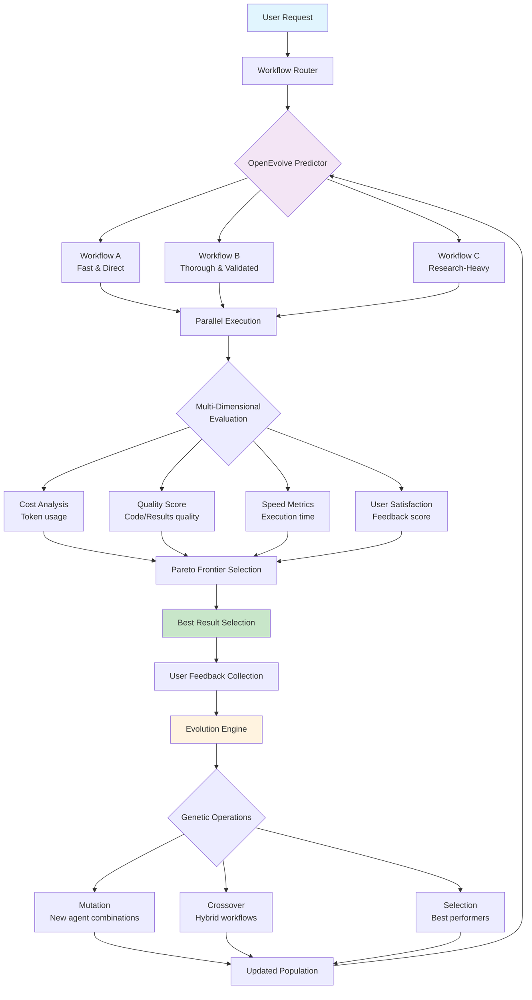

# 🧬 EVO: Evolutionary Multi-Agent Workflow System

## 🎯 Vision

EVO rappresenta la prossima evoluzione dell'AI agent orchestration: un sistema che non solo coordina multiple AI agents, ma **apprende e si ottimizza autonomamente** attraverso evolutionary algorithms per trovare la combinazione ottimale di agenti, tools e workflows per ogni specifico task.

## 🏗️ Architettura Core

### 3-Layer Agent Architecture con Token Separation

```
┌─────────────────────────────────────────────────────────┐
│ CLAUDE CODE (Master Orchestrator)                      │
│ • Token Window 1: Claude Sonnet/Opus                   │
│ • Role: Coordinamento, context, decisioni high-level   │
│ • Calls: MCP servers, subagents, workflow routing      │
└─────────────────────┬───────────────────────────────────┘
                      │
        ┌─────────────┴─────────────┐
        │                           │
┌───────▼──────────┐    ┌──────────▼────────────┐
│ SUBAGENT CLAUDE  │    │ MCP SERVER PYDANTIC   │
│ (Domain Expert)  │    │ (Deep Specialist)     │
│ • Token Window 2 │    │ • Token Window 3      │
│ • Claude API     │    │ • Gemini/GPT/Local    │
│ • Requirements   │    │ • Domain expertise    │
│ • Planning       │    │ • Code generation     │
│ • Architecture   │    │ • Context7 RAG        │
└──────────────────┘    └───────────────────────┘
```

## 🔄 Evolutionary Workflow System

### Il Problema Fondamentale
Come determinare quale combinazione di agenti è ottimale per raggiungere l'obiettivo dell'utente? E come valutare continuamente e migliorare questi workflows?

### La Soluzione: OpenEvolve Integration



## 📊 Multi-Dimensional Workflow Optimization

### Metriche di Valutazione

```python
class WorkflowMetrics:
    cost: float           # Token cost totale ($)
    latency: float        # Tempo esecuzione (seconds)
    quality: float        # Accuratezza output (0-10)
    completeness: float   # Coverage requirements (0-100%)
    reliability: float    # Success rate (0-100%)
    maintainability: float # Code quality score (0-10)
    user_satisfaction: float # User feedback (0-10)
```

### Esempi di Workflow per "Crea strategia trading NautilusTrader"

| Workflow | Agents | Cost | Time | Quality | Use Case |
|----------|---------|------|------|---------|----------|
| **Fast** | `ClaudeCode → MCP_NautilusTrader` | $0.10 | 30s | 7/10 | Quick prototype |
| **Validated** | `ClaudeCode → Planner → MCP_Nautilus → Validator` | $0.25 | 90s | 9/10 | Production-ready |
| **Research** | `ClaudeCode → Context7_RAG → MCP_Nautilus → Tester` | $0.35 | 120s | 9.5/10 | Innovation/novel approach |

## 🧬 OpenEvolve: The Evolution Engine

### Core Capabilities

1. **Adaptive Learning**: Impara quali workflow funzionano meglio per task specifici
2. **Parallel Exploration**: Esegue multiple strategie simultaneamente
3. **Meta-Learning**: Riconosce pattern di successo e li generalizza
4. **Personalization**: Si adatta al coding style e preferenze dell'utente
5. **Cost Optimization**: Trova automaticamente workflow più economici

### Genetic Operations

```python
# Population Evolution Cycle
class WorkflowEvolver:
    def evolve_generation(self, task_results: List[WorkflowResult]):
        # 1. Selection - Keep best performers
        elite = select_pareto_optimal(task_results)
        
        # 2. Crossover - Combine successful patterns  
        offspring = []
        for parent1, parent2 in random_pairs(elite):
            child = crossover_workflows(parent1, parent2)
            offspring.append(child)
        
        # 3. Mutation - Explore new agent combinations
        mutated = []
        for workflow in offspring:
            if random() < mutation_rate:
                mutated.append(mutate_workflow(workflow))
        
        # 4. New Population
        next_generation = elite + offspring + mutated + random_new()
        return next_generation
```

## 🎯 Implementation Roadmap

### Phase 1: Workflow Registry & Basic Router
- [ ] Define workflow templates per task type
- [ ] Implement basic heuristic router
- [ ] Add metrics collection system

### Phase 2: Parallel Execution Engine
- [ ] Implement async workflow execution
- [ ] Add cost/time tracking
- [ ] Create quality evaluation framework

### Phase 3: OpenEvolve Integration
- [ ] Genetic algorithm implementation
- [ ] Fitness function optimization
- [ ] Population management system

### Phase 4: Meta-Learning & Personalization
- [ ] User preference learning
- [ ] Task pattern recognition
- [ ] Automatic workflow discovery

## 🚀 Benefits & Value Proposition

### Cost Efficiency
- **Intelligent routing** to cheapest effective workflow
- **Token optimization** across multiple models
- **Parallel exploration** eliminates trial-and-error

### Quality Improvement  
- **Self-improving system** learns from every execution
- **Multi-agent validation** ensures robust results
- **Domain specialization** via dedicated MCP servers

### Speed & Scalability
- **Parallel workflow execution** 
- **Predictive routing** eliminates exploration overhead
- **Caching of proven patterns**

### Innovation Discovery
- **Unexpected agent combinations** through genetic crossover
- **Novel workflow patterns** via mutation
- **Continuous exploration** of solution space

## 🔬 Research Questions

1. **Fitness Function Design**: Come bilanciare cost, quality, speed in diverse situazioni?
2. **Population Diversity**: Come mantenere diversità ed evitare convergenza prematura?
3. **Transfer Learning**: Come applicare pattern appresi su task simili?
4. **Human-in-the-Loop**: Come integrare feedback umano nel ciclo evolutivo?

## 🛠️ Technical Stack

- **Base Framework**: Pydantic AI + Claude Code MCP
- **Evolution Engine**: OpenEvolve (when available) or custom genetic algorithms  
- **Model Providers**: Claude (orchestration), Gemini (implementation), Local models (experimentation)
- **Knowledge Base**: Context7 for live documentation access
- **Metrics Storage**: SQLite/PostgreSQL for evolution data
- **Orchestration**: Async Python with proper error handling

## 📈 Success Metrics

### System Performance
- **Workflow accuracy improvement** over time
- **Cost reduction** through optimal routing
- **Speed improvement** via pattern recognition

### User Experience  
- **Task completion rate** increase
- **User satisfaction scores** improvement
- **Learning curve reduction** for complex tasks

### Innovation Metrics
- **Novel workflow discovery** rate
- **Pattern generalization** success
- **Cross-domain knowledge transfer** effectiveness

---

## 🔮 Future Vision

EVO non è solo un multi-agent system - è un **self-evolving AI ecosystem** che:

1. **Apprende continuamente** da ogni interazione
2. **Scopre combinazioni innovative** di agenti e tools
3. **Si ottimizza automaticamente** per costi, qualità e velocità
4. **Si personalizza** per ogni utente e contesto
5. **Scala intelligentemente** aggiungendo nuovi agenti al pool

**L'obiettivo finale**: Un sistema che non solo esegue task, ma **evolve autonomamente** per diventare sempre più efficace, efficiente e creativo nella risoluzione di problemi complessi.

---

*Created by: Claude Code + Human Collaboration*  
*Date: January 2025*  
*Status: Conceptual Architecture - Ready for Implementation*